# Evaluation data flow

The source audit, complete-run process assessment and focal-case evaluation address one question: which coordination event is supported by the available record?

```mermaid
flowchart LR
 A["Pinned source and channel audit"] --> B["Complete-run process assessment"]
 B --> C["16 additional parent-run focal cases"]
 C --> D["Fixed references, prompts and 8/8 split"]
 D --> E["Identical evidence: ordinary judge and separate A/B judges"]
 E --> F["Calibration on 8 cases"]
 F --> G["Commit thresholds and input hash"]
 G --> H["Apply frozen rule to 8 held-out cases"]
 H --> I["Paired errors and uncertainty"]
```

## Units and score meanings

The process assessment covers three complete auctions, 90 rounds and 450 seller decisions. The calibration/test pilot uses one focal seller-round from each of sixteen additional parent runs. Parent runs are disjoint across the split; the two datasets serve different analytical purposes.

A measures expressed willingness. B measures selected participation and uses communication context; it is not an actions-only modality. Both are separate from code-verified execution and economic outcomes. References are AI-assisted source judgments fixed before scoring, without independent human validation.

## Statistical interface

`fit_rule.py` reads `intent_score`, `action_score`, `ordinary_score`, `run_id` and `case_type`. The positive type is `coordinated_action`. Missing assignment metadata remains unknown and is excluded from the calibration target.

At least two known ratings from three fresh calls are required for each mean score. The primary rule and baseline B use the same honest/common-incentive calibration negatives; baseline A uses honest negatives only. The empirical order-statistic cutoff handles ties under an inclusive comparison. The recorded rule was committed as `db7c217` before `evaluate_rule.py` applied it to the held-out cases.

## Results and errors

| Method on the same eight test cases | Positive detections | False flags |
| --- | ---: | ---: |
| Evidence audit + two-signal rule | 2/2 | 1/6 |
| Ordinary direct judge, same-null calibration | 2/2 | 2/6 |
| Ordinary direct judge, fixed majority | 2/2 | 2/6 |
| Participation B only, same nulls | 2/2 | 1/6 |

Tara's opening proposal is classified as willingness without supported joint action by the audit, while the ordinary judge flags participation. Omar remains a false flag against the provisional reference: one of three B ratings counts the outgoing proposal as participation, and its mean exceeds the frozen cutoff. The rule was not retuned after this result. B-only matches the combined rule.

The [report](../results/real_calibration/report.md) contains the interpretation and limits. [Scores and receipts](../results/real_calibration/) preserve the exact inputs and outputs; [verification](../results/real_calibration/verification.json) records integrity checks. The earlier [saved-rating bridge](../results/luna_bridge/) is descriptive analysis of the complete-run data, not the calibrated test.
