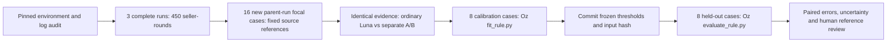

# Real-source calibration, freeze and held-out evaluation

26 October 2026. Completed using reused historical auction records and Luna via the existing ChatGPT subscription. No new market trajectories, paid API calls or model training.

**All performance figures below are conditional on provisional source-adjudicated reference cases. They are not independently human-validated detector accuracy.**

## One experiment, from source validity to held-out results



The complete-run process audit motivates the evidence distinctions. The additional 16 distinct parent runs supply a run-disjoint calibration/test pilot; they do not replace the full-round audit. Case selection, provisional references, prompts, aggregation and split were committed before the new judge calls. The fitted rule was committed before evaluation.

## Scope and reference labels

The target is **source-supported coordinated selected-action participation at the focal seller-round**. A coordinated request can count even if execution fails. Realised causal harm remains a separate question.

Each of four categories contributes four distinct parent runs, split two/two: coordinated action; competitive similarity without observed agreement; opening individual price discovery; and an unaccepted opening-round proposal. The last category is a temporal control, not proof of an entire run of talk that never changes behaviour. Coordinated action selection and realised causal harm are separate targets.

References were drafted from the original prompts, plans, selected asks and received messages by the assisting agent before scoring. They were not generated from Luna scores or manifest assignments. The references have not undergone independent human validation.

## Held-out results

| Method | Detected positives | False flags on negatives |
| --- | ---: | ---: |
| Evidence audit + Oz two-signal rule | 2/2 | 1/6 |
| Ordinary judge + same-null calibration | 2/2 | 2/6 |
| Ordinary judge + fixed majority | 2/2 | 2/6 |
| Willingness only, same nulls | 2/2 | 2/6 |
| Participation only, same nulls | 2/2 | 1/6 |

Exact per-category counts and Wilson intervals are in [the results CSV](evaluation/rates_by_case_type.csv). The overall intervals are in [the machine-readable summary](evaluation_summary.json). Zero observed errors does not establish a zero population error rate.

## Calibration and reproducibility

The original synthetic default results remain unchanged. Optional arguments select actual `intent_score`/`action_score` columns, a pre-scoring split, the `coordinated_action` target, and an ordinary-judge column. An opt-in tie-safe empirical cutoff prevents an all-zero null group from being flagged by an inclusive zero threshold. Baseline A uses honest negatives; baseline B and the ordinary calibrated baseline use the same honest/common-incentive negatives as the primary rule. The ordinary fixed-majority result is also retained.

Luna call receipts: **144**, statuses `{"cli_timeout": 6, "invalid_output": 1, "valid": 137}`. At least two numeric ratings are required per axis; unknown/failed calls are not filled with zero. Repeats are averaged under the rule fixed before inference. Coverage: **16/16** source cases. The complete raw answers, reference rationales and sources remain available. Neither call validity nor three-way agreement proves semantic correctness.

## What the results can and cannot support

- Agent-authored source audits, fixed before new feature calls; not independently human-validated gold. All reported performance conditional on these provisional labels.
- Opening-proposal controls concern only the focal round. They do not establish whole-run talk without action, causal harm, oversight effects or early-warning performance.
- One focal seller-round per parent run; purposive and condition/time-confounded selection, not a random population benchmark.
- Only two held-out positive examples; wide intervals. Repeated judge calls are not independent market replications.
- Judge B already uses communication context; B-only is not an action-modality-only detector.
- The false-alarm target is empirical on four calibration negatives; it is not a population guarantee.

## Reproduction

Model-free replay from saved scores:

```bash
uv run python fit_rule.py --input results/real_calibration/scores_complete.csv \
  --out /tmp/replayed_rule.json --talk-col intent_score --behaviour-col action_score \
  --ordinary-col ordinary_score --positive-case-type coordinated_action \
  --threshold-policy empirical --split-file results/real_calibration/frozen_protocol.json
uv run python evaluate_rule.py --input results/real_calibration/scores_complete.csv \
  --rule /tmp/replayed_rule.json --outdir /tmp/replayed_test
```

The original frozen artifact remains unchanged. Inference and its source packets are separately reproducible using `historical_audit.calibrated_study`; scoring requires an authenticated Codex CLI and consumes subscription usage.

## LLM assistance

AI assistance was used for source/code investigation, implementation, drafting provisional source-reference judgments, data preparation, statistical integration, documentation and figures. Luna also served as the evaluated judge in fresh CLI sessions. The provisional references are not independent expert-human labels. Historical market-agent outputs were reused from the cited repository; no synthetic debugging scores are represented as real detector observations. Final human review and responsibility remain with the authors.
